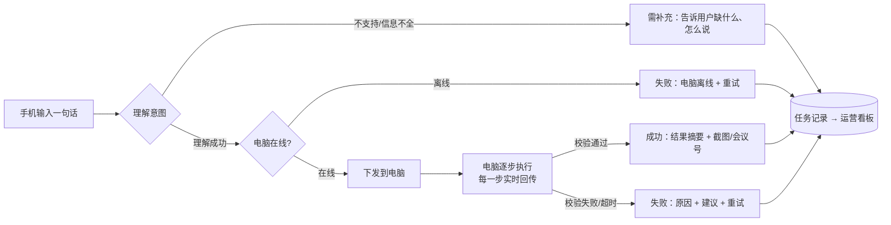
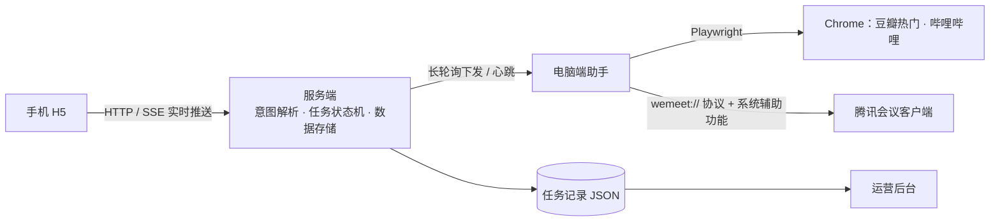

# 龙虾脑 · MVP 产品方案

> 一句话定位：**在手机上说一句话，让家里/办公室的电脑替你把事做完，并把结果告诉你。**

---

## 1. 背景与用户价值

### 1.1 问题
电脑仍然是完成很多事情的主力设备（看片、开会、处理文件），但人并不总在电脑前：

- 躺在沙发上想用客厅电脑投个电影，得起身、开浏览器、搜索、挑视频、点播放；
- 会议马上开始，人在路上，电脑在会议室，需要有人去电脑前入会、开会议；
- 长辈不会操作电脑，但会在手机上说话、打字。

这些任务的共同点是：**目标清晰、步骤固定、但必须在电脑上点很多下。**

### 1.2 价值主张
| 对用户 | 对业务 |
|---|---|
| 不用走到电脑前；一句话代替 5～10 次点击 | 建立“手机 → 电脑”的远程执行入口，后续可扩展任意电脑技能 |
| 全程可见：电脑在做什么、做到哪一步、结果如何 | 每次任务都是结构化数据，可度量、可迭代 |
| 失败时告诉你原因和下一步怎么办 | 先从高频、低风险场景切入，逐步建立用户信任 |

### 1.3 目标用户（MVP）
1. **家庭娱乐用户**：用电脑/电视盒子看视频，想“动嘴不动手”。
2. **远程办公 / 会议室场景**：需要让某台固定电脑快速入会或开会。
3. （远期）**长辈与数字弱势人群**：用自然语言代替复杂操作。

### 1.4 为什么 MVP 先做这两个场景
| 维度 | 搜索并播放视频 | 加入 / 创建腾讯会议 |
|---|---|---|
| 频次 | 高（日常娱乐） | 高（工作日每天多次） |
| 步骤 | 4～5 步，固定 | 3～4 步，固定 |
| 结果可验证 | ✅ 播放进度是否增长 | ✅ 是否出现会中窗口 / 拿到会议号 |
| 风险 | 低（只播放公开内容） | 中（入会涉及隐私，需要防误入） |
| 代表性 | 网页类任务（浏览器自动化） | 桌面应用类任务（系统级自动化） |

两个场景分别覆盖了“网页”和“桌面客户端”两类执行能力，验证通过后可以复制到更多场景。

---

## 2. 产品流程

### 2.1 主流程（端到端闭环）



### 2.2 任务状态机
```
已接收 → 理解中 ─┬→ 需补充（结束）
                 └→ 已下发 → 执行中[步骤1…N] ─┬→ 已完成
                     │                        ├→ 失败（含超时、断线）
                     └→ 已取消（仅未开始时）    
```
设计原则：
- **每一步都可见**：手机上以步骤条展示“确定电影 → 打开浏览器 → 搜索 → 播放 → 确认播放”，每步完成后附带具体信息（如“从豆瓣热门榜选中《黑球》，评分 8.6”）。
- **以结果为准，不以动作为准**：视频必须检测到播放进度在增长才算成功；入会必须检测到会中窗口才算成功。
- **有副作用的任务不自动重试**：服务重启时中断的任务标记为失败、由用户决定是否重试，避免重复入会。

### 2.3 两个场景的执行细节
**场景一：搜索一部热门电影并播放相关视频**
1. 用户没指定片名 → 实时获取豆瓣热门榜第一名（失败时用内置片单兜底）；指定了片名 → 直接使用。
2. 在电脑 Chrome 中打开哔哩哔哩搜索「片名 + 预告片」，选第一个视频。
3. 打开播放页，开始播放并切换网页全屏。
4. 校验播放进度增长，截图回传手机。

**控制类指令（关闭 / 退出）**
- 视频：暂停、继续播放、关闭（关掉龙虾脑打开的播放窗口）；
- 会议：退出会议（主持人/参会者都可）、结束会议（主持人「全员结束」，非主持人自动降级为离开并说明）；
- 泛指「关闭 / 退出」：电脑端检查当前状态——在会议中就离会，在放视频就关闭，什么都没有就如实告知，不做多余操作。

**场景二：腾讯会议**
- 加入：校验 9 位会议号 → 通过 `wemeet://` 协议唤起客户端入会 → 检测会中窗口 → 回传“已进入会议”（或“已进入等候室”）。
- 创建：唤起客户端首页 → 点击「快速会议」→ 检测会中窗口 → 读取会议号回传手机，用户可一键复制转发。

---

## 3. 体验设计与边界

### 3.1 关键体验
| 环节 | 设计 |
|---|---|
| 首次使用 | 电脑后台展示二维码，手机扫码即完成绑定，无需注册账号 |
| 形态 | 对话式个人 Agent：用户和 Agent 一问一答，界面只有对话流和输入框，执行过程不抢视觉 |
| 输入 | 输入框 + 快捷指令胶囊；空状态展示“我能做什么”，降低猜测成本 |
| 理解反馈 | 先展示“我的理解：……”，让用户确认系统没听错 |
| 执行中 | 折叠成一行实时状态（当前步骤 · 进度 2/5），可展开查看每步细节；顶部显示电脑状态（在线/执行中/离线） |
| 结果 | Agent 用自然语言回复：成功附电脑画面截图 / 会议号一键复制；失败说明原因 + 建议 + 重试 |
| 闭环控制 | 能打开也能关闭：暂停/继续/关闭视频、退出/结束会议；只说「关闭」时 Agent 自动判断关什么；成功结果下方给出下一步快捷操作（如「退出会议」） |
| 多轮补充 | 缺会议号或会议号错误时 Agent 追问，用户只需回复数字，Agent 结合上下文继续执行 |
| 历史 | 对话流即历史，可回看每次的执行过程；右上角「清空记录」两次确认后清空对话（只清空用户视图，后台统计数据保留） |

### 3.2 异常处理矩阵（已在 Demo 中实现）
| 异常 | 拦截时机 | 用户看到的提示 | 可执行动作 |
|---|---|---|---|
| 空输入 / 超长 | 提交时 | 请用一句话描述 | 修改指令 |
| 指令不支持（如“订机票”） | 理解阶段 | 这件事我暂时还不会做 + 能力清单 | 修改指令 |
| 缺少会议号 | 理解阶段 | 要加入哪个会议呢？请告诉我会议号 | 修改指令 |
| **会议号格式错误（如 1234）** | 理解阶段 | 会议号「1234」是 4 位，腾讯会议号应为 9 位数字 | 修改指令 |
| 电脑离线 | 下发前 / 执行中 | 电脑当前离线，任务未下发 | 重试 |
| 电脑正在会议中 | 执行前检查 | 为避免打断当前会议，本次没有执行 | 离会后重试 |
| 未安装 / 未登录腾讯会议 | 执行中 | 请先在电脑上安装 / 登录 | 重试 |
| 搜不到视频 / 网络异常 | 执行中 | 没有搜到相关视频 / 请检查电脑网络 | 换片名 / 重试 |
| 视频未能自动播放 | 校验阶段 | 视频页已打开，可在电脑上手动点播放（附截图） | — |
| 执行超时（>2 分钟） | 看门狗 | 电脑响应过慢，结果未确认 | 查看电脑后重试 |
| 排队过多 | 提交时 | 请等当前任务完成后再试 | — |

> 关于题目中的“会议码 1234”：真实腾讯会议号为 9 位，1234 无法入会。Demo 选择**在理解阶段就拦截并给出明确修正建议**，而不是让电脑去尝试后再失败——这样更快、更省资源，也不会在电脑上弹出无意义的错误窗口。

### 3.3 能力边界（MVP 明确不做）
- 不做通用电脑操控（如“帮我整理桌面文件”），只支持白名单场景，确保成功率与安全；
- 不播放付费/版权内容，只播放公开预告片、解说；
- 不代替用户输入会议密码、不代替登录任何账号；
- 入会默认依赖客户端自身设置（建议用户关闭“入会开启摄像头”），产品化阶段需由我们强制“静音、关摄像头入会”；
- 单台电脑同一时间只执行一个任务，其余排队。

### 3.4 安全与隐私
- 手机通过扫码获得设备绑定凭证，未绑定的设备无法下发指令（产品化阶段升级为账号体系 + 设备授权管理）；
- 指令只会被解析为白名单内的结构化任务，**大模型的输出不会直接驱动电脑**，必须再经过规则校验；
- 数据仅保存在用户自己的电脑上（MVP）；
- 截图只回传任务相关画面。

---

## 4. 数据指标体系

### 4.1 北极星指标
**每周成功完成的任务数（WSC, Weekly Successful Commands）**——同时反映用户规模、使用频次和产品可靠性。

### 4.2 指标拆解
| 层级 | 指标 | 定义 | 看板位置 | MVP 目标 |
|---|---|---|---|---|
| 结果 | 端到端完成率 | 成功任务 / 全部指令 | KPI 卡 | ≥ 70% |
| 能力 | 执行成功率 | 成功 / (成功 + 失败)，只算下发到电脑的任务 | KPI 卡、场景表 | ≥ 90% |
| 理解 | 指令理解率 | 成功解析出意图的指令 / 全部指令 | KPI 卡、漏斗 | ≥ 85% |
| 效率 | 平均完成耗时 | 从发出指令到完成 | KPI 卡、场景表 | 视频 ≤ 10s，会议 ≤ 10s |
| 质量 | 失败原因分布 | 按统一异常码聚合 | 原因 Top 图 | 用于确定下个迭代修什么 |
| 转化 | 任务漏斗 | 发出 → 理解 → 下发 → 成功 | 漏斗图 | 定位最大流失环节 |
| 留存（产品化后） | 次日/7日留存、人均周任务数 | — | — | 7 日留存 ≥ 30% |

### 4.3 Demo 实测数据（2026-11-03，本机 MacBook）
| 场景 | 实测耗时 | 结果 |
|---|---|---|
| 搜索热门电影并播放 | 6.0 秒 | 成功（豆瓣热门《黑球》→ B 站官方预告，已验证播放进度） |
| 创建腾讯会议 | 8.4 秒 | 成功（会议号 913 812 935 回传手机） |
| 加入腾讯会议 | 8.4 秒 | 成功（检测到会中窗口） |
| 加入会议 1234 | 即时 | 理解阶段拦截，提示 9 位会议号 |
| 电脑离线时下发 | 即时 | 拦截并提示电脑离线 |

### 4.4 运营看板（Demo 已实现）
- KPI：任务总数、端到端完成率、执行成功率、平均完成耗时、指令理解率；
- 近 7 天任务趋势（成功/失败/需补充）；
- 任务转化漏斗；场景表现（任务数、成功率、平均耗时）；失败与异常原因 Top；
- 任务明细（可按状态筛选），设备在线状态，手机扫码绑定入口；
- 支持“包含模拟历史数据”开关，区分真实数据与演示数据。

**用数据驱动迭代的例子**：如果看板显示“需补充信息”主要来自“缺少会议号”，下一步就做“从剪贴板/日历自动读取会议号”；如果“视频未能自动播放”占比高，就优先做登录态托管或换播放源。

---

## 5. 技术方案（极简）



- **服务端与电脑端助手分离**：与真实产品形态一致（云端服务 + 电脑上的常驻客户端），因此能真实演示“电脑离线”；
- **意图解析**：默认本地规则（零成本、可解释、稳定）；可选接入任意兼容 OpenAI 协议的大模型（DeepSeek、通义等），失败自动回退规则；
- **执行器**：网页类用 Playwright 驱动本机 Chrome；桌面类用 URL Scheme 优先、系统辅助功能兜底；
- **结果校验**：每类任务都定义“成功的客观证据”（播放进度、会中窗口、会议号）；
- **跨平台**：Demo 以 macOS 作为执行端；执行器按“任务 → 原子动作”分层，平台相关部分（唤起应用、模拟点击）可替换，正式产品可直接适配 Windows（UI Automation / pywinauto）。
- **AI 工具使用**：Demo 的代码、页面与本文档由 AI 编程助手（Claude Code）协作完成，从需求梳理到端到端联调约半天。

---

## 6. MVP 后续规划（产品化路径）

| 阶段 | 时间 | 目标 | 关键动作 |
|---|---|---|---|
| **V0 Demo**（当前） | 已完成 | 验证闭环可行 | 2 个场景、异常体系、看板 |
| **V1 种子用户** | 1～2 个月 | 验证真实需求与留存 | 打包为一键安装的电脑客户端（Mac + Windows）；云端中转，手机不再限制同一 Wi-Fi；入会强制静音关摄像头；招募 50～100 名种子用户 |
| **V2 场景扩展** | 3～4 个月 | 提升使用频次 | 扩展到 10+ 高频场景（腾讯视频/爱奇艺、飞书/钉钉会议、打开文件、关机/锁屏、定时任务）；语音输入；从日历自动识别会议 |
| **V3 平台化** | 6 个月+ | 形成生态 | 大模型规划 + 技能插件机制（开放给第三方贡献技能）；多设备管理；家庭/团队共享 |
| **商业化** | V2 之后 | — | 个人免费 + 高级订阅（更多技能、多设备）；企业会议室版（批量设备、会议室自动入会，按设备收费） |

**每个阶段的进入条件**由数据决定：V1→V2 需要执行成功率 ≥ 90%、7 日留存 ≥ 30%；否则继续打磨现有场景。

---

## 7. 风险与应对
| 风险 | 影响 | 应对 |
|---|---|---|
| 第三方软件改版导致自动化失效 | 场景成功率下降 | 优先使用官方协议/接口；失败原因实时监控，看板异常即告警；按版本适配 |
| 远程控制带来的安全顾虑 | 用户不敢用 | 设备绑定、白名单技能、敏感操作二次确认、全程可见可追溯 |
| 系统权限门槛（macOS 辅助功能等） | 首次使用流失 | 安装引导中一步步带用户开权限，并解释用途；无权限时降级为“唤起 + 手动确认” |
| 视频网站登录/风控 | 播放失败 | 登录态托管；多播放源兜底 |
| 大模型理解偏差 | 执行错误任务 | 模型只做理解，执行前强制规则校验；先展示“我的理解”，高风险任务需确认 |
